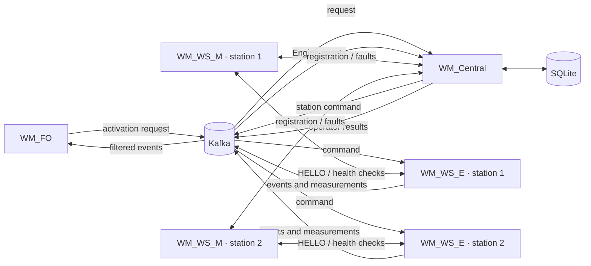

# WaterManagement Release 1 — implementation and verification report

**Prepared:** 18 October 2026  
**Scope:** the current repository implementation and reported local
verification. This report does not claim a Railway deployment or completion of
the final two-PC lab acceptance test.

## 1. Problem and requirements

WaterManagement coordinates irrigation requests among operators and remotely
monitored watering stations. The system needs to authorize a request against
the current operator/station state, operate the Engine's valve safely, provide
progress and final measurements, and keep durable station and irrigation
records across Central restarts. Multiple stations operate concurrently, so
each station needs its own Monitor–Engine connection and independent irrigation
state.

The implementation retains the assignment's two communication styles for
different purposes. The Monitor's registration and health protocol remains
framed TCP. Kafka carries asynchronous irrigation commands and events. SQLite
is Central's durable record; transient connectivity and per-second telemetry
remain runtime state.

## 2. Component responsibilities and topology

- **WM_Central** validates operator and station requests, applies station
  policy, owns the status/control terminal, consumes Engine events, and stores
  station, fault, request, and final-result records.
- **WM_WS_M (Monitor)** enrolls/authenticates its configured station ID and
  location with Central. It maintains the Engine socket session, sends health
  checks at the configured one-second default, and reports fault and recovery
  events.
- **WM_WS_E (Engine)** connects to its matching Monitor and requires the
  `HELLO_ACK` session before accepting irrigation. It operates the valve and
  flow meter, consumes commands, and publishes start, telemetry, rejection,
  and completion events.
- **WM_FO (Field Operator)** submits a station and duration for its operator ID
  and displays the corresponding authorization, progress, denial, and final
  result.
- **Kafka** connects the asynchronous request/command/event path. Topic names,
  fields, correlation IDs, and event types are specified in the
  [Kafka contract](kafka-message-contract.md).
- **SQLite** stores durable facts. The local Docker deployment puts the
  database under `/data` on the named `central-data` volume; restarting Central
  does not remove that volume.

## 3. Irrigation message flow

1. FO publishes an `ACTIVATION_REQUEST` containing `ws_id`, `operator_id`, a
   positive whole-number duration, and a unique `request_id`.
2. Central checks that the operator and station are registered and that the
   station is available. It records the request, publishes `START_IRRIGATION`
   to `wm.ws.commands`, and sends authorization or denial on
   `wm.operator.events`.
3. The station Engine consumes the command. A matching station ID and an
   established Monitor session are required before it starts. An Engine that is
   blocked, failed, or disconnected from its Monitor emits a rejection rather
   than opening the valve.
4. After starting, the Engine publishes `IRRIGATION_STARTED` and cumulative
   `IRRIGATION_TELEMETRY` (flow rate, volume, and elapsed duration). When the
   cycle ends, it publishes `IRRIGATION_COMPLETED` with final measurements and
   an end reason.
5. Central updates SQLite and forwards progress and completion to FO. The
   request ID keeps the messages attached to the same irrigation throughout
   the workflow.

The socket protocol uses the shared frame format
`<STX> JSON <ETX> <LRC>`, where LRC is the XOR of the JSON payload bytes. It is
used for Monitor registration/control responses and Monitor–Engine
handshaking/health messages; it is not the Kafka envelope format.

## 4. Station state, controls, and persistence

Central does not store the visible station status as one mutable field. It
derives it from durable administrative state, open faults, active irrigation,
and current Monitor connectivity. The precedence is:

1. No Monitor connection: `DISCONNECTED` (grey).
2. Open fault: `LEAK` (red).
3. Administratively blocked: `OUT_OF_SERVICE` (orange, displayed as “Out of
   Service”).
4. Active irrigation: `WATERING` (blinking green in the terminal display).
5. Otherwise: `AVAILABLE` (green).

The precedence makes a safety fault visible over an administrative block, and
keeps a block or fault durable while the station is disconnected. The
[ADR-001 state-model decision](adr/ADR-001-state-model-and-schema.md) describes
the rationale and schema invariants.

Central's terminal accepts `START <station|all> <seconds> [operator_id]`,
`BLOCK <station|all>`, `ACTIVATE <station|all>`, `HELP`, and `QUIT` (see
`WM_Central/monitoring.py` for the exact parser and output). BLOCK persists the
administrative state and stops active irrigation; ACTIVATE refuses stations
that are disconnected or faulted. START issues an irrigation through the same
command path.

SQLite uses constraints and unique indexes to enforce one live irrigation per
station, one open fault per station, and one row per request ID. Those checks
make duplicate request delivery safe and prevent competing Central handlers
from authorizing two simultaneous cycles for one station. Central persists
final measurements and administrative/fault state, while live connectivity
and per-second telemetry are derived/runtime data. The schema migration adds
the supported `MONITOR_UNAVAILABLE` Engine rejection reason without discarding
existing irrigation rows. SQLite enables foreign keys and WAL mode; one shared
connection is protected by a reentrant lock, and state-changing transactions
use `BEGIN IMMEDIATE` so validation and insertion cannot race another Central
handler.

## 5. Reliability and recovery behavior

- **Engine–Monitor loss:** the Engine closes the valve, reports the final
  available measurement when possible, clears its ready state, and retries
  connection with bounded backoff. Irrigation cannot start until the
  Monitor handshake succeeds again.
- **Engine health failure:** Monitor reports the fault to Central. Central's
  derived station state becomes `LEAK`; a later healthy response resolves the
  fault and restores availability, subject to connectivity and administrative
  state.
- **Monitor reconnect:** registration is once per successful Central session.
  A real disconnection leads to a new registration on reconnection; routine
  one-second health checks do not create repeated registrations.
- **Central restart during watering:** the SQLite database and Kafka offsets
  persist. Central preserves a `WATERING` record at startup so a queued Engine
  completion can add the actual duration and volume after Central returns.
  Replay is guarded by request IDs and idempotent state transitions.
- **FO process restart:** an operator's stable Kafka group resumes from its
  last committed offset. A completion left unprocessed can be displayed when
  that operator reconnects, without replaying all topic history to every new
  FO process. Run one active FO consumer per operator; members of one Kafka
  group divide partitions instead of receiving broadcast copies.
- **Concurrent stations:** each station has a separate Engine consumer group,
  Monitor socket, Engine socket, and irrigation controller. Local concurrent
  watering has been exercised for two stations.

Kafka consumers use manual commits after their handlers succeed. This gives
at-least-once processing, not exactly-once side effects in every crash window;
the database's unique request IDs and guarded transitions provide the
application-level idempotency. The local single-node Kafka broker has no broker
redundancy.

## 6. Local deployment and verification

`docker-compose.local.yml` starts Kafka, Central, two Monitor/Engine station
pairs, and an on-demand FO profile. Kafka advertises `kafka:29092` to Compose
clients and `localhost:9092` to host clients. Central's SQLite file is under
`/data` on `central-data`; Kafka uses a separate `kafka-data` volume. The
[local deployment guide](local-docker-deployment.md) documents build, startup,
operator launch, status/log checks, and safe restart commands.

Reported verification for this submission:

- Latest full automated run: **189 passed, 1 skipped, 26 subtests passed**.
  The skipped test is the opt-in real-broker integration test when run as part
  of the default suite.
- The real-Kafka activation-to-completion integration test passed separately
  with the local broker enabled.
- Local Docker smoke checks, station/Engine recovery, Central restart recovery,
  and overlapping irrigation on both local stations have been exercised.
- The checks verified request authorization, irrigation start, telemetry,
  completion measurements, and persistence/reconnection behavior. The Docker
  guide contains the repeatable commands; no captured screenshots or raw
  acceptance-test transcript are currently kept in the repository.

These results describe local testing only. A container build or local test run
does not establish cloud operation or the laboratory network topology.

## 7. Decisions and limits

The principal design decision is to keep durable administrative/fault facts
separate from fast-changing connectivity and derived display status. This
avoids restoring stale `AVAILABLE` or `WATERING` labels after a Central restart.
Kafka is used where producer and consumer lifetimes are independent; the socket
protocol remains for the existing Monitor relationships and one-second
health-check exchange. SQLite is sufficient for the single Central process in
Release 1 and is protected by schema constraints and a persistent local volume.

Still pending:

- **Railway:** deploy Central, Kafka, and persistent SQLite storage, then verify
  that the cloud services remain available. No Railway deployment is claimed.
- **Two-PC acceptance:** run multiple FO instances from one laboratory PC and
  multiple Monitor/Engine station instances from another, using the actual
  cloud-to-lab network addresses. This final acceptance test is pending.
- **Operational evidence:** capture and retain the final assessment logs or
  screenshots, and confirm the instructor can access the repository.
- **Assessment readiness:** both students should be prepared to explain the
  state model, concurrency, socket framing, Kafka correlation, and the recovery
  paths described here.
