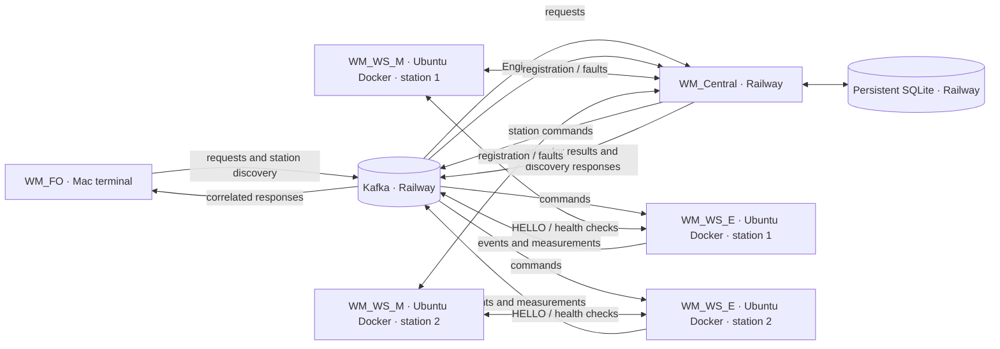

# WaterManagement Release 1 — implementation and verification report

**Prepared:** 31 October 2026
**Scope:** the implemented system, the active Railway Central deployment, and
the completed two-PC live acceptance tests through 31 October 2026. The latest
Railway Central deployment is commit `9da925b` (`Add FO station discovery and
Central status presentation`), confirmed successful and active in the Railway
dashboard.

## 1. Problem and requirements

WaterManagement coordinates irrigation requests among operators and remotely
monitored watering stations. The system needs to authorize a request against
the current operator/station state, operate the Engine's valve safely, provide
progress and final measurements, and keep durable station and irrigation
records across Central restarts. Multiple stations operate concurrently, so
each station needs its own Monitor–Engine connection and independent irrigation
state.

The implementation retains the assignment's two communication styles for
different purposes. The Monitor's registration and health protocol remains
framed TCP. Kafka carries asynchronous irrigation commands and events. SQLite
is Central's durable record; transient connectivity and per-second telemetry
remain runtime state.

## 2. Component responsibilities and topology



The live topology uses Railway Central, Kafka, and persistent SQLite in Railway
Central; PC1 is a Mac running Field Operator instances from the project's
virtual environment with `python -m WM_FO.main`; PC2 is Ubuntu running two
Docker Monitor/Engine pairs. Both PCs connect to Railway through the configured
network endpoints and authenticated Kafka TLS/SASL connection. The Mac Field
Operator was run from the terminal, not in Docker. Field Operators communicate
with Central through Kafka, and Engines communicate with Central through
Kafka. Monitors communicate with Central through the configured socket endpoint;
each Monitor communicates with its Engine through the existing socket protocol,
including its health-check exchange.

- **WM_Central** validates operator and station requests, applies station
  policy, owns the status/control terminal, consumes Engine events, and stores
  station, fault, request, and final-result records.
- **WM_WS_M (Monitor)** enrolls/authenticates its configured station ID and
  location with Central. It maintains the Engine socket session, sends health
  checks at the configured one-second default, and reports fault and recovery
  events.
- **WM_WS_E (Engine)** connects to its matching Monitor and requires the
  `HELLO_ACK` session before accepting irrigation. It operates the valve and
  flow meter, consumes commands, and publishes start, telemetry, rejection,
  and completion events.
- **WM_FO (Field Operator)** discovers currently available stations, submits
  duration, target-volume, or manual-stop requests, including sequential JSONL
  request files, and displays progress and final results with request and
  station IDs.
- **Kafka** connects the asynchronous request/command/event path. Topic names,
  fields, correlation IDs, and event types are specified in the
  [Kafka contract](kafka-message-contract.md).
- **SQLite** stores durable facts. The deployed Central uses persistent Railway
  storage; the local Docker deployment puts the database under `/data` on the
  named `central-data` volume.

## 3. Irrigation message flow

1. FO publishes an `ACTIVATION_REQUEST` containing `ws_id`, `operator_id`, one
   optional mode (`duration_seconds` or `target_volume_liters`), and a unique
   `request_id`. Omitting both limits means run until manually stopped.
2. Central checks that the operator and station are registered and that the
   station is available. It commits the request and stable-keyed outgoing
   command/operator messages together in its SQLite outbox. Delivery retries
   after restart until Kafka confirms each record.
3. The station Engine consumes the command. A matching station ID and an
   established Monitor session are required before it starts. An Engine that is
   blocked, failed, or disconnected from its Monitor emits a rejection rather
   than opening the valve.
4. After starting, the Engine publishes `IRRIGATION_STARTED` and cumulative
   `IRRIGATION_TELEMETRY` (flow rate, volume, and elapsed duration). When the
   cycle ends, it publishes `IRRIGATION_COMPLETED` with final measurements and
   an end reason.
5. Central updates SQLite and forwards progress and completion to FO. The
   request ID keeps the messages attached to the same irrigation throughout
   the workflow.

For station discovery, FO sends a fresh Kafka request and correlates Central's
response by `request_id`. Central validates that the operator exists and is
active, obtains station state from `StateManager.snapshot()`, filters for
`AVAILABLE`, and returns each available station's ID and location to the
requesting operator.

The socket protocol uses `<STX><DATA><ETX><LRC>`, where DATA is a UTF-8 JSON
object and LRC is the XOR of its bytes. Both peers use the shared framing and
LRC validation; this is the Monitor registration/control and Monitor–Engine
handshake/health protocol, separate from Kafka envelopes. Central applies a
10-second registration read timeout and a bounded 5-second response write
timeout, then permits idle registered sockets while TCP keepalive detects dead
peers. Monitors continue the configured one-second health-check cadence and
use a bounded health response timeout; on connection loss they report the
failure and reconnect/re-register with Central.

## 4. Station state, controls, and persistence

Central does not store the visible station status as one mutable field. It
derives it from durable administrative state, open faults, active irrigation,
and current Monitor connectivity. The precedence is:

1. No Monitor connection: `DISCONNECTED` (grey).
2. Open fault: `LEAK` (red).
3. Administratively blocked: `OUT_OF_SERVICE` (orange, displayed as “Out of
   Service”).
4. Active irrigation: `WATERING` (green/bold with a visible marker).
5. Otherwise: `AVAILABLE` (green).

The precedence makes a safety fault visible over an administrative block, and
keeps a block or fault durable while the station is disconnected. The
[ADR-001 state-model decision](adr/ADR-001-state-model-and-schema.md) describes
the rationale and schema invariants.

Central's optional interactive terminal presents a numbered menu for status,
single/all eligible irrigation, block, and activate actions. It is isolated on
its own daemon thread; absent/non-interactive stdin disables only the menu and
stdin EOF never shuts down the service. BLOCK persists the administrative
state and stops active irrigation; ACTIVATE refuses stations that are
disconnected or faulted. START issues irrigation through the same transactional
outbox path. Headless Central also provides an authenticated HTTP admin API;
public use requires HTTPS through Railway's TLS-terminating domain and a
configured token. Railway resources and cross-network access have been
deployed and verified; see the [deployment runbook](railway-deployment.md).

The Central status panel displays station ID, location, status, flow rate in
L/min, accumulated volume in litres, the active operator ID while watering,
and the request ID. `AVAILABLE` is green; `WATERING` is green/bold with a
visible marker; `LEAK` is red; `OUT_OF_SERVICE` is orange with the exact caption
`Out of Service`; and `DISCONNECTED` is grey. Terminal colors use ANSI output
when appropriate. `NO_COLOR` and redirected or non-interactive output are
respected.

SQLite uses constraints and unique indexes to enforce one live irrigation per
station, one open fault per station, and one row per request ID. Those checks
make duplicate request delivery safe and prevent competing Central handlers
from authorizing two simultaneous cycles for one station. Central persists
final measurements and administrative/fault state, while live connectivity and
per-second telemetry are derived/runtime data. The schema migration adds the
supported `MONITOR_UNAVAILABLE` Engine rejection reason without discarding
existing irrigation rows. SQLite enables foreign keys and WAL mode; one shared
connection is protected by a reentrant lock, and state-changing transactions
use `BEGIN IMMEDIATE` so validation and insertion cannot race another Central
handler.

## 5. Reliability and recovery behavior

- **Engine–Monitor loss:** the Engine closes the valve, reports the final
  available measurement when possible, clears its ready state, and retries
  connection with bounded backoff. Irrigation cannot start until the Monitor
  handshake succeeds again.
- **Engine health failure:** Monitor reports the fault to Central. Central's
  derived station state becomes `LEAK`; a later healthy response resolves the
  fault and restores availability, subject to connectivity and administrative
  state.
- **Monitor reconnect:** registration is once per successful Central session.
  A real disconnection leads to a new registration on reconnection; routine
  one-second health checks do not create repeated registrations.
- **Central restart during watering:** the SQLite database and Kafka offsets
  persist. Central preserves a `WATERING` record at startup so a queued Engine
  completion can add the actual duration and volume after Central returns.
  Replay is guarded by request IDs and idempotent state transitions. Live
  verification also confirmed that the persisted final volume is restored
  after a Central restart; this is the latest request measurement, not a
  lifetime cumulative total.
- **Engine process restart:** its local SQLite recovery store preserves the
  request and latest measurements. Recovery closes the valve and publishes a
  final interrupted result instead of restarting the cycle; an unpublished
  completion remains queued with a stable message ID.
- **FO process restart:** an operator's stable Kafka group resumes from its
  last committed offset. A completion left unprocessed can be displayed when
  that operator reconnects, without replaying all topic history to every new
  FO process. Run one active FO consumer per operator; members of one Kafka
  group divide partitions instead of receiving broadcast copies.
- **Concurrent stations:** each station has a separate Engine consumer group,
  Monitor socket, Engine socket, and irrigation controller. Two stations were
  live-tested concurrently on separate PCs.
- **Central outage:** an irrigation already in progress could finish while
  Central was unavailable. Central accepted no new requests during the outage;
  after recovery, the completion result reached the operator.

Kafka consumers use manual commits after their handlers succeed. This gives
at-least-once processing, not exactly-once side effects in every crash window;
the database's unique request IDs and guarded transitions provide the
application-level idempotency. The local single-node Kafka broker has no broker
redundancy. Topics use three partitions by default. Activation requests,
commands, and station events key by `ws_id`; operator notifications key by
`operator_id`. This retains order per entity within each topic and allows
partition-level parallelism; there is no global ordering across keys or topics.

## 6. Deployment and verification

The live deployment uses Railway Central, Kafka, and persistent SQLite. PC1 is
a Mac running the Field Operator from the project's virtual environment; PC2 is
Ubuntu running two Docker Monitor/Engine pairs. Authenticated Kafka TLS/SASL
and the configured network endpoints connect both PCs to Railway. The local
`docker-compose.local.yml` remains available for development and starts Kafka,
Central, two Monitor/Engine station pairs, and an on-demand FO profile. Kafka
advertises `kafka:29092` to Compose clients and `localhost:9092` to host clients.
The [local deployment guide](local-docker-deployment.md) documents local build,
startup, operator launch, status/log checks, and safe restart commands. The
[Railway deployment runbook](railway-deployment.md) records the cloud setup.

### Field Operator live behavior

OP_001 requested a fresh available-station list and received:

| Station | Location | Status |
|---|---|---|
| WS_001 | North Garden | AVAILABLE |
| WS_002 | South Garden | AVAILABLE |

After Central blocked WS_001, FO refreshed and showed only WS_002. After Central
activated WS_001 again, a fresh list showed both stations.

FO supports a JSONL request file, with one request per line. For example:

```jsonl
{"ws_id": "WS_001", "duration_seconds": 5}
{"ws_id": "WS_002", "duration_seconds": 5}
```

FO reads and validates the file, submits one request, and waits for its terminal
result, whether successful or denied. Before submitting the next request, FO
waits four seconds. There is no additional four-second wait after the final
request. A denied request does not stop processing; FO continues with the next
request. The command-line option is `--request-file`; a complete example using
environment variables for the endpoint and operator is:

```bash
python -m WM_FO.main \
  --kafka-host "$KAFKA_HOST" \
  --kafka-port "$KAFKA_PORT" \
  --operator-id "$OPERATOR_ID" \
  --request-file requests.jsonl
```

The live three-line request-file run produced these results:

| Order | Request | Result |
|---|---|---|
| 1 | WS_001, 5 seconds | Completed, 0.5 L |
| 2 | WS_999, 5 seconds | Denied, `UNKNOWN_OPERATOR_OR_STATION` |
| 3 | WS_002, 5 seconds | Completed, 0.5 L |

Logs showed approximately four seconds between the first completion and
processing the second request, and between the second denial and processing
the third. FO continued after the denial. Central subsequently displayed both
stations as AVAILABLE, flow 0.0 L/min, with latest request volume 0.5 L each.

### Central status and station administration live behavior

OP_001 started WS_001 for 20 seconds. During irrigation, Central showed
`WATERING`, flow 6.0 L/min, accumulated volume 0.4 L in the captured status
snapshot, operator ID OP_001, and the correct request ID. At completion,
WS_001 returned to AVAILABLE, flow returned to 0.0 L/min, and final volume was
approximately 2.0 L. WS_002 remained AVAILABLE.

Central blocked WS_001 using option 4. It changed to Out of Service while
WS_002 remained AVAILABLE. Central then activated WS_001 using option 6; it
returned to AVAILABLE and its previous final volume remained preserved. FO's
available-station list excluded WS_001 while blocked and included it again
after activation.

### Two-PC live acceptance and resilience results

- **Normal irrigation:** authorization, start, telemetry, and completion were
  observed across Railway and the two PCs. Final volume and flow rate were
  reported, and results reached the correct operator-specific FO.
- **Concurrency:** OP_001 watered WS_002 for 20 seconds and completed with
  2.0 L; OP_003 watered WS_001 for 15 seconds and completed with 1.5 L. Both
  requests completed successfully.
- **Busy station protection:** a second operator's request to a station that
  was already watering was denied with `WS_BUSY`.
- **Manual station control:** the local Engine station menu started and stopped
  irrigation. The request completed with reason `MANUAL_STOP`; valve closure
  and final measurement were confirmed.
- **Simulated Engine KO:** during active irrigation, the Engine's simulated
  `f` key failure closed the valve. Central displayed WS_001 as `LEAK`, FO
  received `ENGINE_FAULT`, and the last measured volume was retained. Clearing
  the simulated failure restored `HEALTH_OK`; Central returned WS_001 to
  AVAILABLE and WS_002 remained AVAILABLE.
- **Abrupt process crashes:** earlier Engine/Monitor process-crash recovery
  exercises are separate from the simulated `f` key Engine-KO test above.
  Recovery and reconnection were exercised, but those earlier crash tests are
  not the evidence for the simulated Engine-KO sequence.
- **Central outage:** an active irrigation finished while Central was
  unavailable. No new request was accepted during the outage, and the
  completion result reached the operator after Central recovered.
- **Persistence:** a Central restart restored the persisted final request
  volume. The display is the latest request measurement rather than a lifetime
  cumulative volume.

### Automated validation

The latest Codex validation reported **83 focused tests passed** and **293
tests passed, 3 skipped** in the full suite. The three skipped tests require
explicit opt-in integration flags and a Kafka broker; the full Kafka
integration suite was not run against Railway for this implementation.
`git diff --check`, local PLAINTEXT Compose validation, and Railway-overlay
Compose validation passed. These automated unit/integration and Compose
checks are separate from the live two-PC Railway acceptance tests above.

## 7. Final verification matrix

| Requirement | Verification method | Outcome |
|---|---|---|
| Railway Central, Kafka, persistent SQLite | Railway dashboard and live two-PC use; active deployment commit `9da925b` | PASS |
| Two-PC deployment | Mac FO terminal and Ubuntu Docker Monitor/Engine pairs connected to Railway | PASS |
| Multiple Field Operators | Live operator-specific results for OP_001 and OP_003 | PASS |
| Multiple Watering Stations | WS_001 and WS_002 deployed and exercised | PASS |
| FO station discovery | Fresh request, block exclusion, activation restoration | PASS |
| FO one-off irrigation | Live authorization through completion and result delivery | PASS |
| FO JSONL requests and four-second delay | Three-line live run and logs around each transition | PASS |
| Continue after denied request | WS_999 denial followed by successful WS_002 request | PASS |
| Concurrent irrigation | OP_001/WS_002 and OP_003/WS_001 both completed | PASS |
| Busy station rejection | Second request against watering station returned `WS_BUSY` | PASS |
| Central status and operator ID | Live WATERING snapshot with flow, volume, operator, and request ID | PASS |
| Block and activate | Central options 4 and 6; FO list and preserved volume checked | PASS |
| Manual station control | Local Engine menu; `MANUAL_STOP`, valve closure, final measurement | PASS |
| Engine KO and recovery | Simulated `f` failure, `ENGINE_FAULT`, `HEALTH_OK`, availability restored | PASS |
| Monitor/Engine disconnection and recovery | Process-crash/reconnection exercises | PASS |
| Central restart and persistence | Restart restored final request measurement | PASS |
| Central outage behavior | Existing cycle completed; no new request accepted; result delivered after recovery | PASS |
| Automated test suite | Focused/full runs and Compose validations reported above | PASS |
| Terminal color appearance in captured output | No committed visual capture verifying rendered ANSI colors | Pending |
| Screenshots or raw acceptance transcript in repository | None included in repository | Pending |
| Instructor/professor GitHub permissions | Not checked | Pending |

## 8. Remaining limitations and evidence gaps

The Railway dashboard confirmed the active deployment, and the live tests
covered the described two operators and two stations. Every possible number of
FO or WS instances has not been live-tested. The report does not include
screenshots or a retained raw acceptance transcript, and terminal colors were
not visually captured. Professor GitHub permissions have not been checked.
The full Kafka integration suite was not run against Railway; the three
broker-dependent opt-in tests remain skipped in the reported full suite.

The principal design decision remains to keep durable administrative/fault
facts separate from fast-changing connectivity and derived display status.
This avoids restoring stale `AVAILABLE` or `WATERING` labels after a Central
restart. Kafka is used where producer and consumer lifetimes are independent;
the socket protocol remains for the existing Monitor relationships and
one-second health-check exchange. SQLite serves the single Central process and
is protected by schema constraints and persistent storage.
